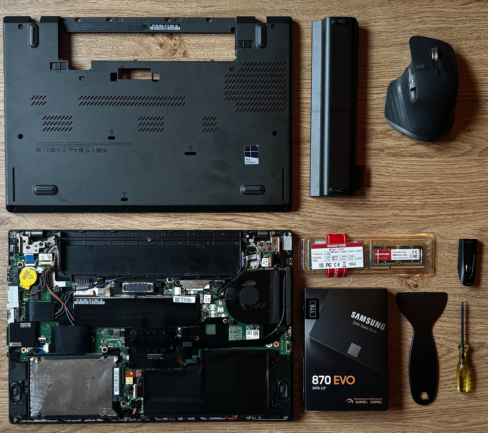
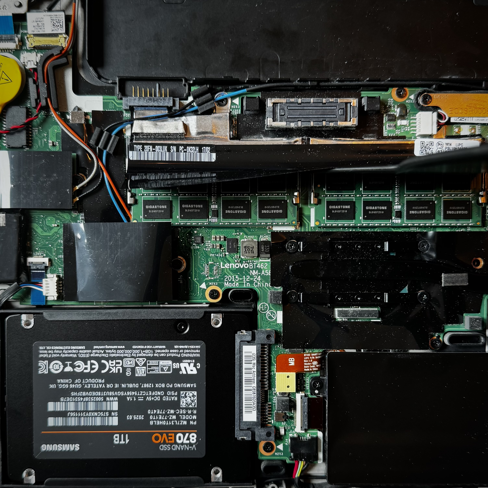

[🇬🇧 English](README.md) | [🇫🇷 Français](README.fr.md)

# Laboratoire de cybersécurité en environnement d'entreprise 

J'ai mis en place un laboratoire informatique auto-hébergé basé sur Active Directory et plusieurs outils de supervision de sécurité. L'objectif était de mieux comprendre le fonctionnement des infrastructures Windows, la collecte et le traitement des journaux via un SIEM, la télémétrie des postes de travail ainsi que la détection des activités suspectes dans un environnement représentatif d'une infrastructure d'entreprise.

Le laboratoire a finalement été décommissionné à la suite de problèmes récurrents de stabilité et de limitations matérielles. Cette expérience m'a toutefois permis de développer des compétences pratiques en diagnostic des problèmes d'authentification, en gestion des ressources, en centralisation des journaux et en résolution de problèmes liés à la virtualisation.

---

## Environnement technique

| Composant | Fonction |
|---|---|
| Windows Server | Active Directory, DNS, DHCP |
| Windows 11 | Poste client intégré au domaine |
| Ubuntu 22.04 Desktop | Poste client Linux |
| Wazuh | SIEM et centralisation des journaux |
| Security Onion | Supervision réseau et détection d'intrusion (IDS) |
| Kali Linux | Simulation d'attaques |

---

## Réalisations

- Mise en place d'un réseau virtuel isolé avec VirtualBox
- Déploiement d'Active Directory avec DNS et DHCP
- Intégration de postes Windows au domaine
- Centralisation des journaux des postes dans Wazuh
- Intégration de Sysmon pour améliorer la visibilité sur l'activité des terminaux
- Déploiement de Security Onion pour la surveillance du trafic réseau
- Simulation d'activités offensives depuis une machine Kali Linux
- Analyse des alertes issues de la supervision des postes et du réseau

---

### Passage de Windows à Ubuntu Linux sur ma machine hôte

J'ai remplacé Windows par Ubuntu Linux sur ma machine principale afin de bénéficier d'un système plus léger et plus fluide. J'ai également pris goût au travail directement depuis le terminal.

### Mise à niveau matérielle de mon ordinateur portable

J'ai effectué plusieurs améliorations matérielles sur mon ordinateur portable Lenovo principal avant de passer définitivement à un MacBook Pro, afin de disposer de davantage de puissance de calcul pour mes environnements virtualisés.

---

## Simulation d'attaques

J'ai utilisé cet environnement pour simuler différentes techniques couramment rencontrées lors d'attaques au sein d'un réseau d'entreprise, notamment :

- Reconnaissance et énumération du réseau
- Attaques visant les identifiants
- Élévation de privilèges
- Déplacements latéraux au sein du réseau
- Techniques de persistance

L'objectif était de mieux comprendre comment se manifestent les activités malveillantes du point de vue d'un défenseur, et comment les identifier à l'aide des outils de supervision et de détection.

---

## Problèmes rencontrés

Ce projet a connu plusieurs échecs et reconstructions avant d'atteindre un niveau de stabilité satisfaisant.

Les principales difficultés rencontrées étaient les suivantes :

- Consommation excessive de mémoire par Elasticsearch
- Mauvaises configurations DNS perturbant l'authentification Active Directory
- Désynchronisation de l'horloge des machines virtuelles entraînant des erreurs Kerberos
- Consommation excessive des ressources lors de l'utilisation simultanée de Security Onion et Wazuh
- Saturation du processeur et de la mémoire vive avec plusieurs machines virtuelles en fonctionnement
- Problèmes de compatibilité avec certains outils de virtualisation après mon passage à Apple Silicon

La principale leçon que j'en ai tirée est que les outils de supervision et de sécurité peuvent rapidement devenir très gourmands en ressources, même dans un environnement relativement limité.

Plutôt que de continuer à reconstruire une infrastructure difficile à stabiliser, j'ai décidé de décommissionner le laboratoire et de repenser mes futurs projets autour d'une architecture plus légère, modulaire et évolutive.

---

## Principaux enseignements

- Active Directory repose fortement sur une configuration DNS fiable et une synchronisation précise de l'horloge.
- Les plateformes SIEM nécessitent des ressources matérielles importantes.
- Les outils de sécurité peuvent rapidement atteindre les limites des infrastructures sur lesquelles ils fonctionnent.
- Le diagnostic et la résolution de problèmes dans des systèmes distribués sont des compétences essentielles en ingénierie informatique.
- Des déploiements progressifs et modulaires sont plus faciles à maintenir que des environnements complexes regroupant tous les services.
- La stabilité et la maintenabilité sont aussi importantes que les fonctionnalités.

---

## Pourquoi j'ai décommissionné le projet

L'environnement était devenu trop gourmand en ressources pour fonctionner de manière fiable sur mon matériel personnel.

Plutôt que de continuer à corriger des problèmes de stabilité récurrents, j'ai préféré archiver le projet et orienter mes prochains travaux vers des infrastructures davantage basées sur le cloud.

Mes futurs projets porteront notamment sur :

- Les infrastructures cloud
- L'Infrastructure as Code (IaC)
- Les déploiements modulaires
- Les pipelines de centralisation des journaux évolutifs
- La supervision et la sécurité des environnements cloud

---

## Prochaines étapes

La prochaine évolution de ce projet sera consacrée à la sécurité cloud avec Microsoft Azure, avec un intérêt particulier pour :

- La gestion des identités et des accès (IAM)
- La centralisation et l'analyse des journaux
- Le développement de règles et de mécanismes de détection (*Detection Engineering*)
- L'Infrastructure as Code (IaC)
- Les solutions de supervision natives du cloud

---

## Conclusion

Ce projet m'a permis d'acquérir une expérience pratique dans plusieurs domaines :

- Active Directory
- Administration de systèmes Windows et Linux
- Supervision SIEM
- Télémétrie des terminaux
- Diagnostic et dépannage réseau
- Virtualisation et gestion des ressources
- Fiabilité et stabilité des infrastructures

Même si le laboratoire a finalement été décommissionné, sa mise en place et les nombreux problèmes rencontrés m'ont beaucoup appris.

Au-delà de la configuration des différents outils, cette expérience m'a surtout permis de mieux comprendre les contraintes réelles liées au déploiement, à la supervision et à la maintenance d'une infrastructure de sécurité.

Un environnement qui fonctionne parfaitement dès le départ n'est pas nécessairement celui qui permet d'apprendre le plus. Les difficultés rencontrées, les erreurs de configuration et les problèmes de stabilité ont finalement été parmi les aspects les plus formateurs de ce projet.
